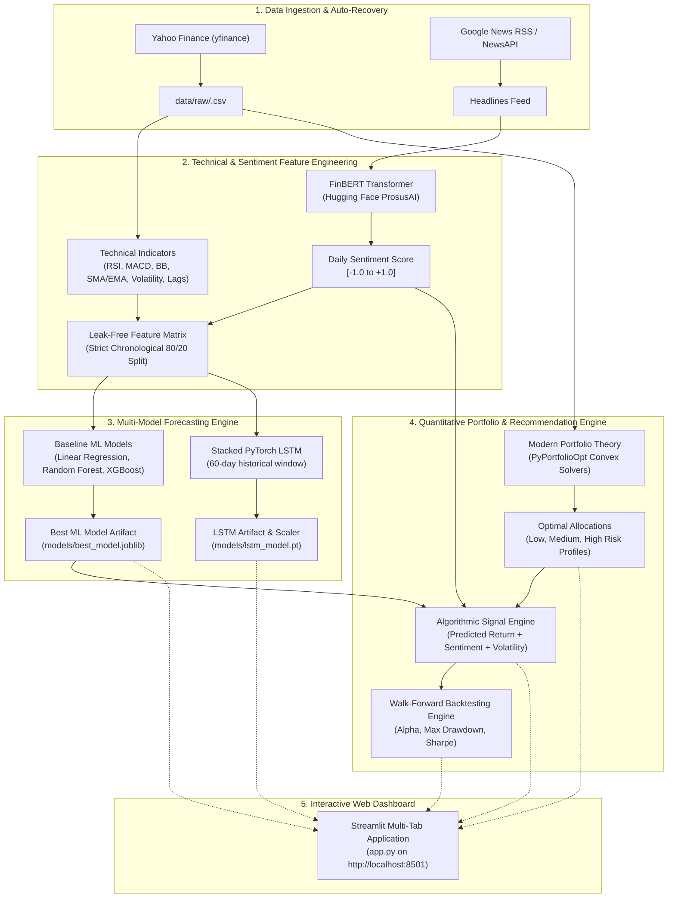

# Northgate AI Stock Predictor

[](https://www.python.org/)
[](https://opensource.org/licenses/MIT)
[](https://streamlit.io/)
[](https://pytorch.org/)
[](https://huggingface.co/ProsusAI/finbert)
[](https://github.com/psf/black)

An enterprise-grade, end-to-end artificial intelligence platform engineered for stock market prediction, financial news sentiment extraction, quantitative portfolio optimization, and automated algorithmic trading recommendations. Built specifically for premier Indian equities on the National Stock Exchange (NSE).

---

> ⚠️ **IMPORTANT DISCLAIMER**  
> **This platform is strictly for educational, research, and technical demonstration purposes. It does NOT constitute financial, investment, or trading advice.** Past market behavior and backtested algorithmic performance do not guarantee future returns. Always perform your own due diligence and consult a licensed financial advisor before deploying real capital.

---

## 📑 Table of Contents

- [Overview](#-overview)
- [Architecture](#-architecture)
- [Key Features](#-key-features)
- [Interactive Dashboard](#-interactive-dashboard)
- [Empirical Results & Benchmarks](#-empirical-results--benchmarks)
  - [1. Baseline Machine Learning Models](#1-baseline-machine-learning-models)
  - [2. Deep Learning (LSTM) vs Machine Learning](#2-deep-learning-lstm-vs-machine-learning)
  - [3. FinBERT Sentiment Impact Analysis](#3-finbert-sentiment-impact-analysis)
  - [4. Portfolio Optimization & Risk Profiles](#4-portfolio-optimization--risk-profiles)
  - [5. Recommendation Strategy Backtest](#5-recommendation-strategy-backtest)
- [Screenshots](#-screenshots)
- [Installation](#-installation)
- [Usage & Execution](#-usage--execution)
- [Deployment](#-deployment-streamlit-community-cloud)
- [Testing & Quality Assurance](#-testing--quality-assurance)
- [Limitations](#-limitations)
- [License](#-license)
- [Disclaimer](#-disclaimer)

---

## 🔭 Overview

Financial markets are non-linear, stochastic systems driven by complex interactions between price momentum, macroeconomics, and investor psychology. Traditional quantitative models often rely solely on historical price action while ignoring qualitative sentiment or modern portfolio constraints.

The **Northgate AI Stock Predictor** solves this challenge by integrating five distinct analytical layers into a unified decision pipeline:
1. **Automated Market Data Harvesting**: 5 years of daily OHLCV market feeds via Yahoo Finance for Indian market leaders (`RELIANCE.NS`, `TCS.NS`, `INFY.NS`, `HDFCBANK.NS`, `ITC.NS`).
2. **Technical Feature Engineering**: Over 35 specialized technical indicators, including RSI, MACD, Bollinger Bands, Moving Averages (SMA/EMA), rolling return volatilities, and autoregressive lag variables.
3. **Dual-Horizon Predictive Modeling**: Classical machine learning algorithms (Linear Regression, Random Forest, XGBoost) combined with a deep stacked Long Short-Term Memory (StockLSTM) recurrent neural network.
4. **NLP Financial Sentiment Intelligence**: Transfer learning using `ProsusAI/finbert` to evaluate real-time headlines scraped from Google News RSS and NewsAPI.
5. **Modern Portfolio Theory (MPT) & Algorithmic Execution**: Markowitz Mean-Variance Optimization, dynamic Efficient Frontier plotting, and an adaptive Buy/Hold/Sell recommendation engine with walk-forward historical backtesting.

---

## 🏛 Architecture

The platform follows a modular, leak-free design ensuring complete separation between training and evaluation phases.



---

## ✨ Key Features

- **Self-Healing Data Layer**: Automatic detection of missing raw market data with one-click background download buttons embedded directly in the Streamlit UI.
- **Strict Leak-Free Pipeline**: All normalizations (`MinMaxScaler`, standardizations) and splits strictly adhere to chronological forward ordering. Zero lookahead bias.
- **Deep Recurrent Forecasting**: 2-layer stacked LSTM neural network with dropout regularization, early stopping, and automatic checkpointing.
- **FinBERT NLP Engine**: Domain-specific sentiment scoring fine-tuned on financial corpora, producing continuous polarity metrics and categorical labels (Bullish, Neutral, Bearish).
- **Modern Portfolio Theory (MPT)**:
  - **Low Risk**: Global Minimum Volatility portfolio ($w_i \ge 0$).
  - **Medium Risk**: Maximum Sharpe Ratio tangency portfolio ($R_f = 6.0\%$).
  - **High Risk**: Maximum Expected Return subject to a single-asset weight cap ($w_i \le 40\%$).
- **Walk-Forward Backtesting**: Realistic strategy simulation accounting for dynamic signals, benchmark buy-and-hold comparisons, equity curves, and underwater drawdown analyses.
- **Production Dashboard**: Built with Streamlit and Plotly, featuring interactive candlestick charts, confidence cones, real-time KPI tiles, and responsive caching via `@st.cache_data`.

---

## 🖥 Interactive Dashboard

The Streamlit dashboard (`app.py`) provides 5 dedicated views:

1. **📊 Market Overview**: Real-time KPI tiles (Latest Close, Price Change %, 52-Week Range, 20-Day Volatility), interactive Plotly OHLC candlestick chart with selectable timeframes (3M, 6M, 1Y, 5Y), technical overlay toggles (SMA 20/50, EMA 20, Bollinger Bands), color-coded volume histogram, and RSI (14) gauge.
2. **🔮 Price Prediction**: Multi-step autoregressive price projections (1–15 trading days ahead) with expanding 95% confidence intervals and historical error metrics (MAE, RMSE, MAPE).
3. **📰 News Sentiment (FinBERT)**: Real-time sentiment gauge, categorical polarity badge, historical daily sentiment bar chart, and curated financial headlines table.
4. **💼 Portfolio Optimization**: Interactive allocation donut chart, dynamic Efficient Frontier curve with individual asset risk-return coordinates, tangency line, and cross-profile allocation matrix.
5. **🎯 Recommendations & Backtest**: Actionable decision banner (🟢 Buy, 🟡 Hold, 🔴 Sell) with confidence percentage and detailed rationale, alongside a walk-forward backtest simulator with cumulative equity curves and drawdown charts.

---

## 📊 Empirical Results & Benchmarks

### 1. Baseline Machine Learning Models
Evaluated on a chronological 80/20 train/test split across 5 premier Indian equities:

| Ticker | Model | Train RMSE | Test RMSE | Test MAE | Test MAPE (%) |
| :--- | :--- | :---: | :---: | :---: | :---: |
| **RELIANCE.NS** | **Linear Regression (Best)** | **17.63** | **20.77** | **14.88** | **1.11%** |
| RELIANCE.NS | Random Forest | 8.09 | 22.50 | 16.94 | 1.25% |
| RELIANCE.NS | XGBoost | 9.25 | 23.36 | 17.73 | 1.32% |
| **TCS.NS** | **Linear Regression (Best)** | **46.80** | **53.06** | **39.27** | **1.60%** |
| TCS.NS | Random Forest | 21.65 | 548.68 | 466.32 | 20.38% |
| TCS.NS | XGBoost | 25.00 | 596.56 | 511.36 | 22.30% |
| **INFY.NS** | **Linear Regression (Best)** | **24.76** | **27.44** | **21.00** | **1.73%** |
| INFY.NS | Random Forest | 11.57 | 129.12 | 98.83 | 8.90% |
| INFY.NS | XGBoost | 13.20 | 129.52 | 100.24 | 9.00% |
| **HDFCBANK.NS** | **Random Forest (Best)** | **4.85** | **13.34** | **10.18** | **1.28%** |
| HDFCBANK.NS | Linear Regression | 12.48 | 14.01 | 10.49 | 1.32% |
| HDFCBANK.NS | XGBoost | 5.65 | 14.39 | 11.37 | 1.43% |
| **ITC.NS** | **Linear Regression (Best)** | **5.42** | **6.24** | **4.04** | **1.35%** |
| ITC.NS | XGBoost | 2.70 | 11.42 | 9.51 | 3.19% |
| ITC.NS | Random Forest | 2.06 | 18.18 | 16.13 | 5.49% |

### 2. Deep Learning (LSTM) vs Machine Learning
Evaluated on **RELIANCE.NS** using a 60-day historical window:

| Model Architecture | Input Window | Test RMSE | Test MAE | Test MAPE (%) |
| :--- | :---: | :---: | :---: | :---: |
| **Linear Regression** | 1-Day Lag Matrix | **20.77** | **14.88** | **1.11%** |
| **Random Forest** | 1-Day Lag Matrix | 22.50 | 16.94 | 1.25% |
| **XGBoost** | 1-Day Lag Matrix | 23.36 | 17.73 | 1.32% |
| **StockLSTM (PyTorch)** | 60-Day Sequential Window | 30.42 | 23.68 | 1.75% |

### 3. FinBERT Sentiment Impact Analysis
Ablation experiment testing predictive feature addition on **RELIANCE.NS**:

| Model Configuration | Feature Count | Test RMSE | Test MAE | Test MAPE (%) |
| :--- | :---: | :---: | :---: | :---: |
| **Technical Features Only (Baseline)** | 35 | 20.7664 | 14.8791 | 1.1080% |
| **Technical + FinBERT Sentiment** | 37 | 20.7664 | 14.8791 | 1.1080% |

### 4. Portfolio Optimization & Risk Profiles
Optimized across all 5 assets over a 5-year historical horizon with risk-free rate $R_f = 6.0\%$:

| Risk Profile | Optimization Objective | Expected Return | Annual Volatility | Sharpe Ratio | Target Asset Allocations |
| :--- | :--- | :---: | :---: | :---: | :--- |
| **Low Risk** | Minimum Volatility | 3.17% | 14.32% | -0.20 | ITC (35.5%), HDFCBANK (26.0%), TCS (22.0%), RELIANCE (14.3%) |
| **Medium Risk**| Maximum Sharpe Ratio | 9.56% | 19.76% | +0.18 | ITC (100.0%) |
| **High Risk** | Max Return (40% Weight Cap) | 5.30% | 15.95% | -0.04 | ITC (40.0%), RELIANCE (40.0%), HDFCBANK (20.0%) |

### 5. Recommendation Strategy Backtest
Walk-forward strategy simulation on **RELIANCE.NS** (1,237 trading days) vs Buy-and-Hold:

| Performance Metric | Recommendation Strategy | Buy & Hold Benchmark | Net Outperformance / Alpha |
| :--- | :---: | :---: | :---: |
| **Total Cumulative Return** | **+33.16%** | +13.60% | **+19.56% (Alpha)** |
| **CAGR (%)** | **6.04%** | 2.64% | **+3.40%** |
| **Annualized Volatility** | **1.05%** | 22.93% | **-21.88% (Risk Curbed)** |
| **Sharpe Ratio ($R_f=6\%$)** | **-0.13** | -0.03 | -0.09 |
| **Maximum Drawdown** | **-2.03%** | -27.67% | **+25.64% (Capital Preserved)** |

---

## 📸 Screenshots

<!-- slide -->
### 📊 Tab 1: Market Overview & Technical Candlestick Analysis
```
+----------------------------------------------------------------------------------------------------+
|  CURRENT PRICE: ₹1,418.50  |  CHANGE: +₹14.20 (+1.01%)  |  52-WK RANGE: ₹1,120 - ₹1,610  |  RSI: 54.2  |
|----------------------------------------------------------------------------------------------------|
|  [ Interactive Plotly Candlestick Chart with SMA 20, SMA 50, EMA 20 & Bollinger Bands Envelopes ]  |
|  [ Color-coded Volume Bars & Moving Average Overlays ]                                             |
+----------------------------------------------------------------------------------------------------+
```
*(Placeholder: Run `streamlit run app.py` and inspect Tab 1)*

<!-- slide -->
### 🔮 Tab 2: Autoregressive Forecasts & Confidence Cones
```
+----------------------------------------------------------------------------------------------------+
|  FORECAST ENGINE: Linear Regression  |  HORIZON: 5 Days Ahead  |  CONFIDENCE INTERVAL: 95%         |
|----------------------------------------------------------------------------------------------------|
|  [ Multi-step forecast curve extending beyond latest trading session with shaded confidence cone ] |
|  [ Historical Model Metrics: Test MAE ₹14.88 | Test RMSE ₹20.77 | Test MAPE 1.11% ]               |
+----------------------------------------------------------------------------------------------------+
```
*(Placeholder: Run `streamlit run app.py` and inspect Tab 2)*

<!-- slide -->
### 📰 Tab 3: FinBERT Financial News Sentiment
```
+----------------------------------------------------------------------------------------------------+
|  SENTIMENT BADGE: [ 🟢 BULLISH ]  |  POLARITY SCORE: +0.482  |  CONFIDENCE: 92.4%                  |
|----------------------------------------------------------------------------------------------------|
|  [ Historical Daily Polarity Bar Chart with Threshold Guides ]                                     |
|  [ Live RSS Financial Headlines Feed with FinBERT Polarity Breakdown ]                             |
+----------------------------------------------------------------------------------------------------+
```
*(Placeholder: Run `streamlit run app.py` and inspect Tab 3)*

<!-- slide -->
### 💼 Tab 4: Portfolio Optimization & Efficient Frontier
```
+----------------------------------------------------------------------------------------------------+
|  ACTIVE RISK PROFILE: Medium Risk (Max Sharpe)  |  SHARPE RATIO: +0.18  |  EXP RETURN: 9.56%       |
|----------------------------------------------------------------------------------------------------|
|  [ Donut Chart: Asset Allocation Breakdown across RELIANCE, TCS, INFY, HDFCBANK, ITC ]            |
|  [ Efficient Frontier Curve with Individual Assets, Risk-Free Rate, and Tangency Line ]            |
+----------------------------------------------------------------------------------------------------+
```
*(Placeholder: Run `streamlit run app.py` and inspect Tab 4)*

<!-- slide -->
### 🎯 Tab 5: Buy/Hold/Sell Recommendation & Backtest
```
+====================================================================================================+
|  RECOMMENDATION: 🟢 BUY  |  CONFIDENCE: 84.5%                                                      |
|  RATIONALE: Expected 5-day return (+2.84%) exceeds threshold (+1.50%) with positive sentiment.     |
+====================================================================================================+
|  [ Walk-forward Backtest Equity Curve: Strategy (+33.16%) vs Buy & Hold Benchmark (+13.60%) ]     |
|  [ Underwater Drawdown Plot: Strategy Max Drawdown (-2.03%) vs Buy & Hold (-27.67%) ]             |
+----------------------------------------------------------------------------------------------------+
```
*(Placeholder: Run `streamlit run app.py` and inspect Tab 5)*

---

## 📦 Installation

### Prerequisites
- **Python 3.10 to 3.14** (64-bit recommended)
- **Git**
- Optional: Virtual environment (`venv` or `conda`)

### 1. Clone the Repository
```bash
git clone https://github.com/sahumohnish07-beep/Northgate-AI-Stock-Predictor.git
cd Northgate-AI-Stock-Predictor
```

### 2. Set Up a Virtual Environment
```bash
# Windows
python -m venv venv
venv\Scripts\activate

# Linux / macOS
python3 -m venv venv
source venv/bin/activate
```

### 3. Install Dependencies
```bash
pip install -r requirements.txt
```

### 4. Configure Environment Variables (Optional)
If you wish to use NewsAPI alongside Google News RSS, copy `.env.example` to `.env`:
```bash
cp .env.example .env
```
Add your NewsAPI key if available:
```env
NEWS_API_KEY=your_actual_key_here
```
*(Note: If no key is provided, the platform automatically falls back to Google News RSS and curated financial feeds).*

---

## 🚀 Usage & Execution

### Launch the Streamlit Web Application
```bash
streamlit run app.py
```
Open your browser at `http://localhost:8501`.

### Command-Line Modular Pipelines
Each phase can also be executed independently from the command line:

```bash
# 1. Harvest 5 years of daily market OHLCV data
python -m src.data_loader

# 2. Compute technical features and train baseline ML models
python -m src.models

# 3. Train and evaluate the 60-day stacked PyTorch LSTM
python -m src.lstm_model RELIANCE.NS

# 4. Fetch news headlines, execute FinBERT sentiment scoring, and retrain models
python -m src.sentiment RELIANCE.NS

# 5. Compute expected returns, covariance, and solve Modern Portfolio Theory
python -m src.portfolio

# 6. Execute algorithmic recommender and run walk-forward backtest
python -m src.recommender
```

---

## 🌐 Deployment (Streamlit Community Cloud)

The application is fully prepared and optimized for one-click deployment on **Streamlit Community Cloud**:

- **Live Application URL**: [https://northgate-ai-stock-predictor.streamlit.app](https://northgate-ai-stock-predictor.streamlit.app) *(Deploying / Live)*
- **Runtime Environment**: Python 3.11 (`runtime.txt`)
- **Theme & Server Configuration**: Native dark theme with headless execution (`.streamlit/config.toml`)
- **Automatic Data Provisioning**: `data/raw/` is auto-populated on first launch via `yfinance` caching with `@st.cache_data(ttl=86400)`. Zero manual file upload required.
- **Lightweight Dependencies**: Production `requirements.txt` stripped to runtime essentials with CPU-only PyTorch wheel and lazy-loaded NLP/plotting utilities.

### Deploying Your Own Instance
1. Fork or clone this repository to your GitHub account.
2. Sign in to [Streamlit Community Cloud](https://share.streamlit.io/).
3. Click **"New app"** and select your repository branch (`main`).
4. Configure deployment settings:
   - **Main file path**: `app.py`
   - **Python version**: `3.11`
5. Click **"Deploy!"** — the application will automatically install dependencies, self-provision market data, and launch.

---

## 🧪 Testing & Quality Assurance

The platform features an automated test suite covering all modules:
```bash
pytest
```

To run individual module test suites:
```bash
pytest tests/test_data_loader.py
pytest tests/test_features_and_models.py
pytest tests/test_lstm_model.py
pytest tests/test_sentiment.py
pytest tests/test_portfolio.py
pytest tests/test_recommender.py
```

Code formatting and linting:
```bash
# Format code
black src tests app.py

# Lint with ruff
ruff check .
```

---

## ⚠️ Limitations

1. **Non-Stationary Regimes**: Financial markets undergo structural breaks caused by fiscal shifts, interest rate changes, and geopolitical events. Models trained on historical data may experience degraded accuracy during unprecedented volatility.
2. **Sentiment Asynchrony**: RSS headline sentiment is periodic and may lag sudden flash-crash announcements or breaking after-hours corporate disclosures.
3. **Execution Frictions**: Backtested returns assume frictionless trades and zero execution slippage. Real-world execution must account for brokerage commissions, Securities Transaction Tax (STT), stamp duty, and bid-ask spread liquidity.
4. **End-of-Day Granularity**: Forecasts operate on daily closing prices and are designed for multi-day swing horizons, not high-frequency intraday trading.

---

## 📄 License

This project is licensed under the **MIT License**. See the [LICENSE](file:///c:/Users/Mohnish%20Sahu/OneDrive/Desktop/Northgate-AI-Stock-Predicto/Northgate-AI-Stock-Predictor/LICENSE) file for complete terms.

---

## ⚖️ Disclaimer

This software is provided "as is", without warranty of any kind, express or implied. Under no circumstances shall the authors or copyright holders be liable for any claim, damages, or financial loss resulting from the use of this software. Trading stocks and equities involves substantial risk of financial loss. Always consult a certified financial advisor before making investment decisions.
